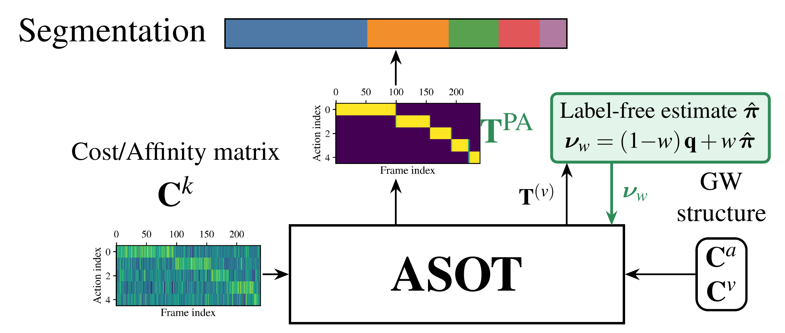

# Applying Optimal Transport to Unsupervised Action Segmentation

Code for **PA-decode** (proportion-aware decoding), a test-time change to
[ASOT](https://github.com/mingu6/action_seg_ot) (Xu & Gould, *Temporally Consistent Unbalanced Optimal Transport for
Unsupervised Action Segmentation*, CVPR 2024).

ASOT decodes each video by solving a fused Gromov-Wasserstein unbalanced optimal transport problem. In this problem,
a KL term pulls the action marginal of the transport plan towards the **uniform** distribution `q = 1/K`. Real
activities are imbalanced (a few actions take most of the frames). PA-decode keeps the trained ASOT model and the
solver unchanged and only replaces the target of the KL term:

```
ν_w = (1 − w) · 1/K + w · π̂
```

- `π̂` estimates the action proportions of the activity **without labels**. It comes from the same model, either
  from the codes (mean soft assignment, `codes`) or from the ASOT transport plan (mean column mass, `plan`).
- `(λ, w, source)` is selected by **2-fold cross-validation** over videos. One configuration is shared by all
  activities of a dataset.
- The main baseline is **ASOT-λ**, which is ASOT with `λ` selected by the same procedure. Both methods use the same
  models and the same seeds.

<p align="center"></p>

## Results

Full protocol, averaged over 10 seeds (10 independently trained ASOT models per activity). The values are MoF / F1 / mIoU (%).

| Method | Breakfast | YTI† | 50 Salads Mid | 50 Salads Eval | Desktop Assembly |
|---|---|---|---|---|---|
| ASOT (paper, single run) | 56.1 / 38.3 / 18.6 | 52.9 / 35.1 / 24.7 | 46.2 / 37.4 / 24.9 | 59.3 / 53.6 / 30.1 | 70.4 / 68.0 / 45.9 |
| ASOT (paper, 5-run avg.) | – | – | 43.0 | 56.4 | 62.9 |
| ASOT, reproduced | 56.01 / 37.66 / 17.91 | 46.33 / 33.89 / 23.07 | 43.37 / 35.99 / 23.56 | 55.94 / 53.02 / 28.75 | 61.30 / 61.64 / 39.82 |
| ASOT-λ | 56.05 / 37.65 / 17.91 | 46.34 / 34.12 / 23.32 | 44.29 / 38.17 / 25.08 | 56.08 / 53.33 / 28.99 | 62.50 / 64.50 / 41.77 |
| **PA-decode (ours)** | 56.52 / 37.39 / 17.92 | 46.52 / 33.77 / 22.79 | 44.63 / 37.50 / 24.42 | 59.13 / 55.55 / 29.27 | 64.25 / 65.61 / 42.43 |

† YTI labels are reconstructed from numeric codes (see [Data](#data)). They are not directly comparable with
published numbers.

PA-decode − ASOT-λ (ΔMoF, 10 seeds; the bootstrap re-runs the parameter selection):

| Setting | ΔMoF | Bootstrap CI95 | Seeds >0/<0/=0 | Pre-registered criterion |
|---|---|---|---|---|
| 50 Salads Eval | +3.05 | [1.77, 3.74] | 8/2/0 | met |
| Desktop Assembly | +1.75 | [1.15, 2.11] | 9/0/1 | met |
| Breakfast | +0.47 | [0.23, 0.58] | 6/3/1 | met |
| 50 Salads Mid | +0.33 | [−0.43, 0.46] | 3/4/3 | not met |
| YTI | +0.18 | [−0.23, 0.52] | 4/5/1 | not met |

All other tables of the paper (per-seed results, the ablation of `w`, the mechanism analysis, and the supervised
MS-TCN++ experiment) are produced by the scripts below.

## Repository structure

```
pa-decode/
├── setup.sh                     # clone ASOT (pinned commit) + pip install
├── run_unsupervised.sh          # full unsupervised pipeline (all steps below)
├── run_supervised.sh            # MS-TCN++ + ASOT / PA-decode post-processing
├── requirements.txt
├── scripts/                     # command-line entry points (one per pipeline step)
│   ├── prepare_data.py          #   0. build data/<dataset>/{features,groundTruth,mapping}
│   ├── train_asot.py            #   1. train ASOT with the authors' code
│   ├── decode.py                #   2. decode with the full grid (ASOT-λ, PA-decode, variants, oracles)
│   ├── evaluate.py              #   3. 2-fold selection, metrics, bootstrap, per-seed tables, verdicts
│   ├── analyze_mechanism.py     #   4. why PA-decode helps (decomposition, permutation, dose-response)
│   ├── make_figures.py          #   5. qualitative bars, transport plans, sensitivity to λ
│   ├── check_cache.py           #   Phase 1: are the v6 models / decoding files found?
│   ├── compare_v6.py            #   Phase 1: results.json == v6 results (criterion R1)
│   ├── evaluate_pervideo.py     #   Phase 1: Per-Video protocol
│   ├── dump_video_stats.py      #   Phase 1: per-video statistics + re-solve check (criterion R3)
│   └── run_supervised.py        #   supervised experiment (Table 3 of ASOT + PA-decode)
├── src/pa_decode/
│   ├── config.py                # all hyper-parameters, grid, pre-registered criteria
│   ├── asot_bridge.py           # imports the authors' ASOT code (third_party/action_seg_ot)
│   ├── data.py                  # dataset preparation (incl. YTI label repair), folds, evaluation units
│   ├── train.py                 # ASOT training wrapper (same call order as the authors' train.py)
│   ├── solver.py                # PA-decode solver, PA-integral, PA-minmax (+ self-checks vs. ASOT)
│   ├── decode.py                # decoding grid and cached decoding
│   ├── metrics.py               # MoF / exact-expectation F1 / mIoU (identical to the authors' metrics.py)
│   ├── selection.py             # 2-fold selection, point estimates, bootstrap
│   ├── report.py                # result tables, significance tests, verdicts, results.json
│   ├── wvideo.py                # upper bound of choosing w per video
│   ├── mechanism.py             # mechanism analysis
│   ├── figures.py               # figures of the paper
│   ├── pipeline.py              # runs the cached stages in order
│   ├── pervideo.py              # Per-Video protocol (Hungarian per video)
│   ├── videostats.py            # per-video proportion estimates, entropy, true proportions (diagnostics)
│   └── supervised/              # MS-TCN++ model, training, eval.py metrics, post-processing, tables
├── tests/                       # unit tests + toy data generator for smoke tests
└── docs/
```

## Installation

```bash
git clone <this repository> pa-decode && cd pa-decode
bash setup.sh            # clones mingu6/action_seg_ot @ 0c4c86b1 into third_party/ and installs requirements
python -m pytest -q      # quick unit tests (no data needed)
```

The experiments were run on Kaggle (T4 GPU). The code was also tested locally with Python 3.13, PyTorch 2.x and
PyTorch Lightning 2.x. A GPU is recommended; everything also runs on CPU, but more slowly.

## Data

The datasets follow the layout of the ASOT repository:

```
data/<FS | desktop_assembly | Breakfast | YTI>/
    features/      groundTruth/      mapping/mapping.txt   (+ mappingeval.txt for 50 Salads)
```

`scripts/prepare_data.py` builds this layout. It searches the folders given with `--raw-root` and downloads any
missing dataset from the links in the ASOT README: Breakfast, YTI and 50 Salads from the
[HOWTO of unsup_temp_embed](https://github.com/Annusha/unsup_temp_embed/blob/master/HOWTO_master.md), and Desktop
Assembly from Google Drive.

```bash
python scripts/prepare_data.py --raw-root /path/to/already/downloaded/data   # optional --raw-root
```

**YTI labels.** In the public YTI release, some ground-truth files store action names and others store numeric
codes. The two id→name tables shipped with the release also disagree. `data.fix_yti_ground_truth` aligns the numeric
and name versions of the same video, keeps the table supported by the data, checks that every code maps to an action
of the video's own activity, and rewrites all files with names.

## Running the experiments

Run everything with `bash run_unsupervised.sh`, or run the steps one at a time. Every step caches its outputs in
`cache/`, so re-running a step only loads what is already done.

```bash
python scripts/train_asot.py         # 180 ASOT models (5 settings × activities × 10 seeds)
python scripts/decode.py             # 150 decoding configurations per (activity, seed)
python scripts/evaluate.py           # -> results/*.csv, results/results.json
python scripts/analyze_mechanism.py  # -> results/mechanism_*.csv, results/figures/dose.pdf
python scripts/make_figures.py       # -> results/figures/{qual_bars,matrices,sensitivity_lambda}.pdf
```

Common options:

| Option | Effect |
|---|---|
| `--datasets FSeval,Breakfast` | run a subset (`FSeval`, `FS`, `desktop_assembly`, `Breakfast`, `YTI`) |
| `--seeds 0,1,2` | run fewer seeds (default: 0–9) |
| `--quick` | smoke test: 2 epochs, 3 seeds, 30 bootstrap rounds (numbers are not meaningful) |
| `--device cpu` | force CPU |

In our runs, training one ASOT model took about 1.2 min (50 Salads), 1.8 min (Desktop Assembly), 1.7 min (Breakfast)
and 0.25 min (YTI) on a Kaggle T4 GPU.

### Where each part of the paper comes from

| Paper | Output |
|---|---|
| Table III (comparison with published methods) | `results/reproduction_asot.csv`, `results/main_<dataset>.csv` |
| Table IV (PA-decode − ASOT-λ) | `results/delta_<dataset>.csv`, `results/significance.csv` |
| Table V (per-seed ΔMoF) | `results/per_seed.csv`, `results/per_activity_seed.csv` |
| Table VI (role of `w`: PA-integral, PA-minmax, per-video `w`) | `results/delta_<dataset>.csv`, `results/per_video_w_bound.csv` |
| Table VII (mechanism) | `results/mechanism_results.json`, `results/mechanism_*.csv` |
| Fig. 3 (cost matrix and transport plans) | `results/figures/matrices.pdf` |
| Fig. 4 (qualitative segmentations) | `results/figures/qual_bars.pdf` |
| Fig. 5 (sensitivity to λ) | `results/figures/sensitivity_lambda.pdf` |
| Fig. 6 (dose-response) | `results/figures/dose.pdf` |

### Methods compared

| Name | Description |
|---|---|
| ASOT | authors' decoding, `λ = 0.01`, uniform target |
| ASOT-λ | ASOT with `λ` selected by 2-fold CV (**main baseline**) |
| PA-decode | target `ν_w`; `(λ, w, source)` selected by 2-fold CV (`w = 0` is included, so it can fall back to ASOT-λ) |
| PA-integral | variant without `w`: closed-form target `exp ∫₀¹ log ν_w dw` |
| PA-minmax | variant without `w`: smooth maximum of `KL(m‖1/K)` and `KL(m‖π̂)` |
| PA-true-proportions | `π̂` replaced by the true dataset proportions (**uses labels**, diagnostic only) |
| Oracle-video | true per-video proportions (**uses labels**, diagnostic only) |

## Phase 1: reproduction from the v6 caches and Per-Video protocol

`run_phase1.sh` re-uses the trained models and decoding files of the Kaggle v6 run (nothing is trained again), checks
that this repository gives exactly the v6 numbers, adds the Per-Video protocol (second block of Table 1 of ASOT) and saves
per-video statistics for the next method. The criteria were fixed before running; see [docs/PHASE1.md](docs/PHASE1.md).

```bash
V6_JSON=/path/to/pa_asot_v6_results.json bash run_phase1.sh
```

| Paper | Output |
|---|---|
| Table III, Per-Video block | `results/pervideo_main.csv` |
| PA-decode − ASOT-λ, Per-Video | `results/pervideo_delta.csv`, `results/pervideo_per_seed.csv` |
| Check against the authors' `trainer.test` | `results/pervideo_check_trainer.csv` |

## Supervised experiment (MS-TCN++ on 50 Salads)

This experiment follows Section 7.4 / Table 3 of ASOT. MS-TCN++ is trained with 3 refinement stages (MS) and
without them (SS), on 5 splits × 3 seeds. ASOT and PA-decode are then applied as post-processing. Here `π̂` comes
from the labels of the **training** split. The metrics are Acc, Edit and F1@{10, 25, 50}, as in MS-TCN `eval.py`.

```bash
bash run_supervised.sh --data-dir /path/to/data/50salads   # MS-TCN format; downloaded from Zenodo if omitted
```

## Tests and smoke test

```bash
python -m pytest -q                                   # solver and metric checks (no data)
python tests/make_toy_data.py --out toy_data          # tiny synthetic datasets
for s in train_asot decode evaluate analyze_mechanism make_figures; do
  python scripts/$s.py --data-dir toy_data --cache-dir toy_cache --out-dir toy_results --quick
done
```

The pipeline also checks itself while it runs:

- The PA-decode solver with a uniform target reproduces `asot.segment_asot`.
- MoF and mIoU equal the authors' `metrics.py` and `trainer.test`.
- The exact-expectation F1 agrees with the authors' Monte-Carlo F1.
- Re-solving with the cached `π̂` reproduces the cached segmentation.

## Reproducibility notes

- The ASOT code is pinned at commit `0c4c86b1`.
- `KMeans` uses `n_init = 10` for the cluster initialisation.
- `np.random.random_integers` (removed in NumPy 2) is mapped to the equivalent `randint` call.
- GPU training is not bit-exact across hardware, so individual seeds may differ slightly. Decoding, selection and
  bootstrap are deterministic given the trained models.
- The decision criteria (G1, K1, K2, H, D and H1–H9) were fixed before the experiments were run. They are encoded in
  `config.py`, `report.py` and `mechanism.py`.

## Acknowledgements

This code builds on [ASOT](https://github.com/mingu6/action_seg_ot) (MIT License) and
[MS-TCN2](https://github.com/sj-li/MS-TCN2). The datasets were released by their respective authors.

## Citation

If you use this code, please cite ASOT:

```bibtex
@inproceedings{xu2024temporally,
  title     = {Temporally Consistent Unbalanced Optimal Transport for Unsupervised Action Segmentation},
  author    = {Xu, Ming and Gould, Stephen},
  booktitle = {Proceedings of the IEEE/CVF Conference on Computer Vision and Pattern Recognition (CVPR)},
  year      = {2024}
}
```

The citation of our paper will be added after publication.
